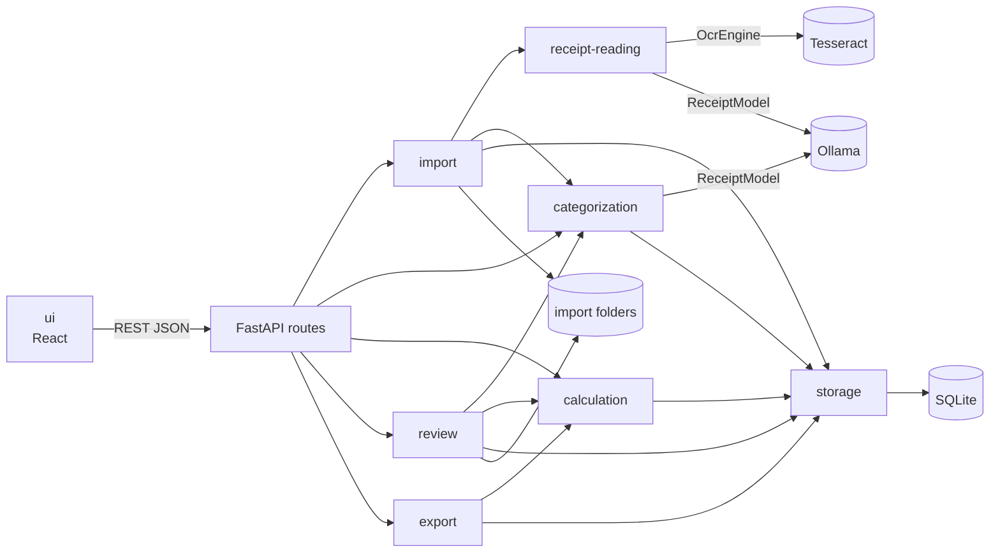
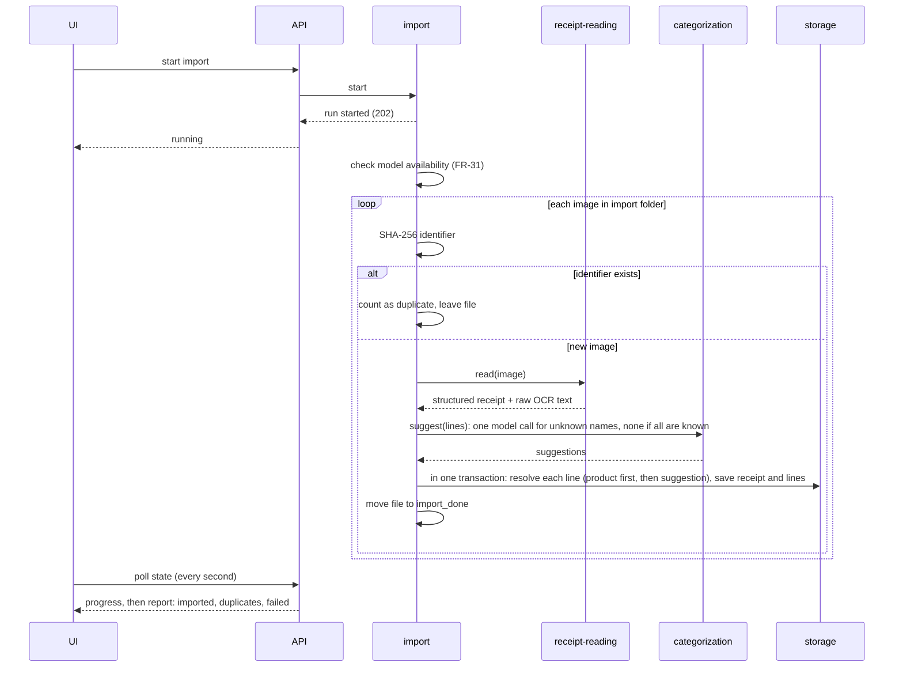

# System Architecture

- **Status:** In Progress (foundation, categorization, import with reading, and receipt
  review with the receipt check implemented; totals and export are target design)
- **Updated:** 2026-10-31

## Overview

RRMCApplication is a local, single-user web app. A Python backend reads receipt images from a
folder, turns them into categorized line items and stores them in SQLite. A React UI, opened
in the browser on the same computer, is used to review receipts, manage categories and
products, and view totals. Nothing runs on a server and no receipt data leaves the computer
(PRD NFR-1, NFR-2).

This document describes the parts of the system, their boundaries and how data flows between
them. Requirements are in [the PRD](../specs/PRD.md); behavior of each feature is in
`specs/features/`. Entities are described in [datamodel.md](datamodel.md) and endpoints in
[api-reference.md](api-reference.md).

The foundation (containers, settings, storage, engine interfaces, health, app shell) exists,
and so do categorization with the Tuotteet page, import with reading and categorization with
the Tuonti page, and receipt review with the Kuitit and receipt pages. Totals, export and
line editing are still the target design (see the greenfield rule in
[AGENTS.md](../AGENTS.md#greenfield-rule)).

## Tech stack

| Area | Choice | Notes |
|---|---|---|
| Backend | Python 3.12, FastAPI, Uvicorn | REST API on `127.0.0.1` only |
| Storage | SQLite (one file) | In a Docker volume, outside version control |
| Image preprocessing | Python imaging library (chosen in the receipt-reading spec) | Grayscale, deskew, contrast, scaling (FR-6) |
| OCR | Tesseract 5.x, `fin` + `eng` | Installed in the backend container |
| Parsing and categorization model | Local model through Ollama | Model name is one setting (FR-29); Ollama on `localhost` with cloud features off |
| Frontend | React, Vite, TypeScript | Finnish UI (NFR-15) |
| Export | CSV; Google Sheets (gspread) in a later release | Behind one exporter interface (FR-27) |
| Tests | pytest; Vitest, React Testing Library, MSW; Playwright | See [Testing seams](#testing-seams) |
| Runtime | Docker Compose | Backend and UI containers; Ollama on Windows. See [Runtime and deployment](#runtime-and-deployment) |

The stack is recorded in [ADR 0001](adr/0001-tech-stack.md) and
[PRD section 8](../specs/PRD.md#8-solution-outline-decided).

## Folder structure

```text
backend/                 FastAPI app and all processing
  app/
    main.py              app factory: settings, logging, CORS, error handlers, routers, lifespan
    prestart.py          start checks before Uvicorn: settings and migrations
    settings.py          settings from RRMC_* environment variables (.env)
    errors.py            AppError and the API error format
    texts.py             Finnish texts of the backend (error messages)
    logging_setup.py     logging to stdout and one log line per request
    storage/             SQLite connection, transactions, migrations/, repositories
    categorization/      catalog: names, rules, default list, routes
    receipt_import/      import runs: file rules, moves, background run, routes
    engines/             OcrEngine and ReceiptModel: real implementations and fakes
    health/              GET /api/health and loading the model at start
    calculation/         sums in integer cents: the receipt check and category subtotals
    review/              receipt endpoints: list, receipt view, image, category choice, review state
    <subsystem>/         one package per feature subsystem (see Component map)
  evaluation/            development tool, not part of the app: compares reading variants
                         on the user's receipts (python -m evaluation)
  tests/unit/            unit tests, one folder per package
  tests/integration/     FastAPI TestClient tests with a temporary database
  tests/evaluation/      tests of the evaluation tool
frontend/                React + Vite + TypeScript UI
  src/api/               shared API client and typed clients, one per resource
  src/components/        components; a page component per feature page (ProductsPage, ImportPage)
  src/navigation.ts      page switching between the pages
  src/i18n/fi.ts         all Finnish UI texts
  src/test/              MSW setup and test data for component tests
  e2e/                   Playwright tests
scripts/                 container tests
docs/                    documentation (see content-plan.md)
specs/                   PRD and feature specs
source/import/           incoming receipt images        (default; gitignored, real data)
source/import_done/      imported images               (default; gitignored, real data)
source/import_failed/    images that failed to import   (default; gitignored, real data)
source/eval/             evaluation receipts, truth files, results (default; gitignored, real data)
compose.yaml             Docker Compose: backend and frontend; profiles e2e and eval
.env.example             committed example settings file; the real .env is not committed
```

The real settings file and the database are not committed (FR-32, NFR-4).

`backend/evaluation/` may import from `app` (settings, name normalization); `app` never
imports from it. It runs only in the `eval` service and adds no endpoint, page or table
([model evaluation spec](../specs/features/model-evaluation.md)).

## Component map



| Subsystem | Responsibility | Does not | PRD |
|---|---|---|---|
| **storage** | SQLite connection, schema and migrations; repositories for categories, products, receipts and lines; transactions | Contain business rules | FR-10, NFR-6, NFR-7 |
| **import** | List images in the import folder, compute the SHA-256 identifier, skip duplicates, run each image through receipt-reading and categorization, commit, then move the file to the done or failed folder; report the run | Read text or choose categories itself | FR-1–FR-5, FR-31, FR-45 |
| **receipt-reading** | Preprocess the image, run OCR, turn the OCR text into a validated structured receipt (store, date, lines, total) with Finnish receipt rules; re-parse stored OCR text | Assign categories or write to the database | FR-6–FR-10 |
| **categorization** | The catalog (groups, categories, products, name normalization, default list) and the assignment of a category to each line: remembered product first, then the model; record the category source; learn from user corrections | Calculate totals | FR-11–FR-15, FR-33–FR-39, FR-43 |
| **calculation** | Category and group totals per ISO week and per month by purchase date; receipt subtotals; line-sum vs receipt-total check; deposit refund handling | Change data | FR-19–FR-20, FR-22–FR-25, FR-44 |
| **review** | The receipt endpoints of the review UI: list with warnings, one receipt with its lines, category names, sums and subtotals, the image from the done folder, a line's category choice, the review state | Calculate sums or remember categories itself | FR-16–FR-21 (backend) |
| **export** | Exporter interface and the CSV exporter; later the Google Sheets exporter | Compute totals itself | FR-26–FR-28 |
| **ui** | Pages: receipts list, receipt review (image beside an editable table), products and categories, totals, import and export actions | Hold business rules; it shows what the API returns | FR-16–FR-21, FR-25, NFR-15 |

Cross-cutting backend modules (`main.py`, `prestart.py`, `settings.py`, `errors.py`,
`texts.py`, `logging_setup.py`) belong to the foundation and are used by every subsystem.
The `health` package reports the state of the database, the image folders, OCR and the model
([api-reference.md](api-reference.md#get-apihealth)), and loads the model at start (FR-30).

### Dependency rules

- The UI talks to the backend only through the REST API.
- API routes are thin: they validate input, call a subsystem service and map errors to HTTP
  responses. Services hold the rules.
- Only **storage** runs SQL. Other subsystems use its repositories.
- Dependencies point one way: `import` → `receipt-reading`, `categorization`, `storage`;
  `categorization` → `storage` and the read line type of `receipt-reading`;
  `export` → `calculation` → `storage`; `review` → `calculation`, `categorization`,
  `storage`. `calculation` does no I/O and depends on nothing. No subsystem depends on
  `import`, `export` or `review`.
- Only **receipt-reading** and **categorization** call Tesseract or Ollama, and only through
  the interfaces below. The exception is **health**, which calls only the interfaces'
  availability checks (`check()`) and the model's `load()`.
- Services that other subsystems need (for example product lookup by normalized name, used by
  FR-43) are plain Python functions or classes, not only API endpoints.

## Data flow

### Import (FR-45: started with a button)

Implemented with the reading and categorization steps and the model check. Details are in
[import](subsystems/import/README.md), [receipt-reading](subsystems/receipt-reading/README.md)
and [categorization](subsystems/categorization/README.md#line-categorization).



- The file moves only after the transaction commits (NFR-7).
- On any failure for an image, nothing is stored for it, and the file moves to
  `import_failed` with a reason that contains no receipt content (FR-4, NFR-3). Its
  identifier is not stored, so it can be retried. The exception is a file that cannot be
  moved to the done folder: it stays in the import folder for a later run.
- If Ollama or the model is unavailable, the run stops before the first image and reports it;
  no image is moved to `import_failed` for that reason (FR-31).
- A run works in a background thread: `POST /api/import` returns at once and the UI polls
  `GET /api/import` while the run is active. Only one run is active at a time; the state is
  kept in memory ([receipt import spec](../specs/features/receipt-import.md), PC8).
- A duplicate stays in the import folder; it is reported on every run until the user
  removes it.

### Review and correction

Implemented for the category choice and the review state
([review](subsystems/review/README.md)); line editing (FR-18, FR-43) comes with its spec.

1. The UI loads a receipt with its lines, categories and subtotals, and the image through an
   API endpoint, which finds the file by its stored name in the done folder only.
2. A category choice is sent to the API. Categorization stores it as the product's
   remembered category and moves the product's other lines with it (FR-13, FR-36). Renamed
   lines will be linked to products (FR-43) by the line editing spec.
3. The answer is the whole receipt with the subtotals and the sum check from calculation
   (FR-19, FR-20). The UI shows it.

### Totals and export

Totals are always calculated from the database when requested; they are not stored.
Exports are generated from the same calculation, so an export always matches the totals view
(FR-26, PRD risk table).

## Key interfaces

| Interface | Owner | Real implementation | Purpose |
|---|---|---|---|
| `ReceiptReader` | receipt-reading | `OcrReceiptReader` (Tesseract, then the text model) | Image in, read receipt out (store, date, total, lines, OCR text); the one interface import calls, so a vision reader can be added later |
| `OcrEngine` | receipt-reading | Tesseract | `orient()` turns the image upright, `read()` returns its text; `check()` tells whether Tesseract with `fin` and `eng` can run |
| `ReceiptModel` | receipt-reading, categorization | Ollama client | `generate(prompt, schema)` returns the model's JSON answer; receipt-reading turns OCR text into a receipt, categorization suggests categories for unknown names ([ADR 0004](adr/0004-line-categorization.md)). Output is validated; invalid output is an error (FR-8). `check()` and `load()` tell whether the model is available and keep it loaded |
| `Exporter` | export | CSV writer; later Google Sheets | Write lines and totals to a target (FR-27) |

Both interfaces live in the shared `engines` package (see
[receipt-reading](subsystems/receipt-reading/README.md#interfaces)). The model is loaded at backend start and kept
loaded while Ollama runs (FR-30); if Ollama is not available then, it is loaded on the first
health check that finds it. The model name is read from settings, so switching model size
needs no code change (FR-29).

Parsing uses a text model on the OCR output, not a vision model on the image
([ADR 0003](adr/0003-receipt-reading-model.md), PRD open question 4). The `ReceiptReader`
interface keeps that choice inside receipt-reading.

## Runtime and deployment

- Runs on the user's Windows computer with Docker (NFR-10). Prerequisites: Docker Desktop,
  Git and Ollama. Python, Node.js and Tesseract run in containers.
- `docker compose up` starts two containers: `backend` (FastAPI with Tesseract) and
  `frontend` (Vite dev server). The same way of running is used for normal use and for
  development; there is no separate production build (NFR-11).
- Ollama runs on Windows, not in a container. The backend reaches it at
  `http://host.docker.internal:11434` (setting `RRMC_OLLAMA_URL`).
- Published ports are bound to `127.0.0.1` only: backend `8000`, UI `5173`. CORS allows only
  the UI origin (NFR-2).
- The import folders on Windows are mounted into the backend container. The SQLite database
  lives in a Docker volume, because SQLite file locking is unreliable on Windows folders
  mounted into Linux containers.
- All settings are in one `.env` file in the project root (FR-32).
- The `eval` service (profile `eval`) runs the model evaluation tool on demand. It publishes
  no port and calls only `RRMC_OLLAMA_URL`; see
  [development.md](development.md#model-evaluation).
- There is no login: the app is local and single-user.
- Details are in the [foundation spec](../specs/features/foundation.md). Setup and start
  commands are in [development.md](development.md#setup).

## Cross-cutting rules

- **Money** is integer cents everywhere: database, services, API. Formatting with a decimal
  comma happens only in the UI and the CSV exporter (NFR-6).
- **Dates:** purchase date is stored as a date; weeks are ISO 8601 (FR-22, FR-23).
- **Names:** product, category and group names are compared by their normalized form
  (FR-14, FR-35); see [categorization](subsystems/categorization/README.md#names).
- **Errors:** the API returns `{"error": "<code>", "message": "<Finnish text>"}`; codes are
  stable and defined per spec.
- **Logging:** no receipt content in logs or error messages (NFR-3).
- **Settings:** one settings file outside version control, with a committed example (FR-32).

## Testing seams

- A setting selects real or fake implementations of `OcrEngine` and `ReceiptModel`. Fakes are
  deterministic, so tests and E2E runs need neither Tesseract nor Ollama (NFR-13).
- Backend tests use a temporary SQLite file per test and synthetic receipts only (NFR-12).
- UI component tests mock the API with MSW; E2E tests run the real backend with the fakes
  (NFR-14).

## Subsystems

Each Tier 2 doc is created with the first spec that touches its subsystem.

- [storage](subsystems/storage/README.md) — SQLite connection and migrations
- [import](subsystems/import/README.md) — import runs, duplicates, moving files, and the
  reading and categorization steps of each image
- [receipt-reading](subsystems/receipt-reading/README.md) — engine interfaces,
  preprocessing, OCR and parsing
- [categorization](subsystems/categorization/README.md) — the catalog (groups, categories,
  products, names, default list), line categories at import, user corrections and FR-36
- [calculation](subsystems/calculation/README.md) — the receipt check and category
  subtotals; weekly and monthly totals come with the totals spec
- [review](subsystems/review/README.md) — the receipt endpoints of the review UI
- export: `docs/subsystems/export/README.md` (not written yet)
- [ui](subsystems/ui/README.md) — app shell, page switching, API client, status line,
  Tuotteet, Tuonti, Kuitit and receipt pages

## Related Documents

- [PRD](../specs/PRD.md): requirements referenced above
- [Product management spec](../specs/features/product-management.md)
- [Receipt import spec](../specs/features/receipt-import.md)
- [ADR 0001: Technology stack](adr/0001-tech-stack.md)
- [ADR 0002: Docker](adr/0002-docker.md)
- [ADR 0003: Receipt reading model](adr/0003-receipt-reading-model.md)
- [ADR 0004: Line categorization](adr/0004-line-categorization.md)
- [Categorization spec](../specs/features/categorization.md)
- [Receipt review spec](../specs/features/receipt-review.md)
- [Foundation spec](../specs/features/foundation.md)
- [datamodel.md](datamodel.md), [api-reference.md](api-reference.md),
  [development.md](development.md)
- [AGENTS.md](../AGENTS.md): development rules and stack
- [Content plan](content-plan.md): documentation index
