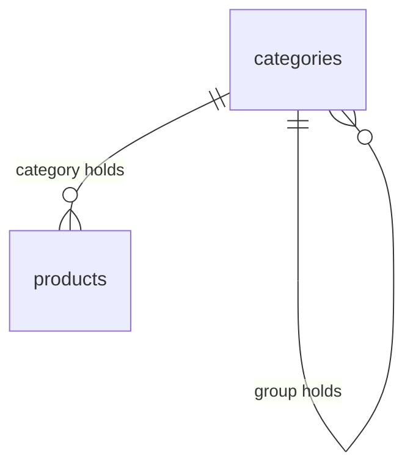

# Data Model

- **Status:** In Progress (catalog entities implemented; receipts and lines come with their specs)
- **Updated:** 2026-10-27

## Overview

The app keeps all its data in one SQLite database. This document describes the schema and
how it changes. Today the schema holds the migration bookkeeping and the catalog: groups,
categories and products. Receipts and lines are added by their feature specs as new
migrations.

## Where the database is

| Item | Value |
|---|---|
| File inside the backend container | `/data/db/rrmc.db` |
| Storage | Docker volume `rrmc_rrmc-data`, mounted at `/data/db` |
| Created | On the first start, by `python -m app.prestart` |

The database is not in a Windows folder, because SQLite file locking is unreliable on
Windows folders mounted into Linux containers ([ADR 0002](adr/0002-docker.md)). It survives
`docker compose down` and image rebuilds; `docker compose down -v` deletes it.

Every connection has foreign keys on and uses the WAL journal
(@backend/app/storage/db.py).

## Entities

### schema_version

One row per applied migration.

| Column | Type | Meaning |
|---|---|---|
| `version` | `INTEGER PRIMARY KEY` | Number of the migration file (`0001_...` → 1) |
| `applied_at` | `TEXT NOT NULL` | When it was applied, UTC ISO 8601 |

The schema version is the largest `version`, or 0 when the table is empty.

### categories

Groups and categories share one table, so they share one name namespace (PRD FR-35). A
**group** holds categories and never products; a **category** holds products and belongs to
one group or to none. The hierarchy has at most two levels.

| Column | Type | Meaning |
|---|---|---|
| `id` | `INTEGER PRIMARY KEY` | Stable id |
| `name` | `TEXT NOT NULL` | Display name, as the user typed it after trimming and collapsing spaces |
| `name_key` | `TEXT NOT NULL UNIQUE` | Normalized name, used for every comparison ([normalization](subsystems/categorization/README.md#names)) |
| `kind` | `TEXT NOT NULL`, `group` or `category` | What the row is |
| `parent_id` | `INTEGER`, references `categories (id)`, `ON DELETE RESTRICT` | The group of a category; always `NULL` for a group (`CHECK`) |

### products

| Column | Type | Meaning |
|---|---|---|
| `id` | `INTEGER PRIMARY KEY` | Stable id; receipt lines will reference it (FR-36) |
| `name` | `TEXT NOT NULL` | Display name |
| `name_key` | `TEXT NOT NULL UNIQUE` | Normalized name; two products cannot share it |
| `category_id` | `INTEGER NOT NULL`, references `categories (id)`, `ON DELETE RESTRICT` | The product's category, never a group |

### app_state

One-time facts about the database, as key and value text.

| Key | Value | Meaning |
|---|---|---|
| `catalog_seeded_at` | UTC ISO 8601 time | The default category list was created; it is never created again, even after the user deletes every item |

### Relationships and rules

- `UNIQUE`, `CHECK` and `RESTRICT` are a safety net. "A parent is a group" and "a product's
  category is not a group" need another row, which SQLite `CHECK` cannot read, so the
  [categorization services](subsystems/categorization/README.md#rules) enforce them, and
  they also check every rule first to return the right error code and count.
- Product names are personal purchase data: they stay in this database and are never logged.

## Migrations

- Migrations are SQL files in @backend/app/storage/migrations/ named `NNNN_name.sql`
  (four digits, then a short name). Today there is one, `0001_catalog.sql`, so the schema
  version is 1.
- On every start, `prestart` and then the app's lifespan apply each file whose number is
  above the schema version, in number order (@backend/app/storage/migrate.py).
- Each file runs in its own transaction together with its `schema_version` row. If it fails,
  that transaction is rolled back, the backend does not start, and the database stays at the
  previous version.
- A migration file must not contain `BEGIN` or `COMMIT`; the runner owns the transaction.
- A committed migration is never edited. A change is a new migration.
- A feature spec that adds tables lists its migration in "Files to Modify" and documents the
  new entities in this file.

## Subsystems

- [storage](subsystems/storage/README.md) — owns the connection, the migration runner and
  all SQL
- [categorization](subsystems/categorization/README.md) — the rules on top of the catalog
  tables

## Related Documents

- [architecture.md](architecture.md): where storage sits among the subsystems
- [Foundation spec](../specs/features/foundation.md) PC4: database requirements
- [Product management spec](../specs/features/product-management.md): the catalog tables
- [development.md](development.md#running-the-app): where the data lives when the app runs
