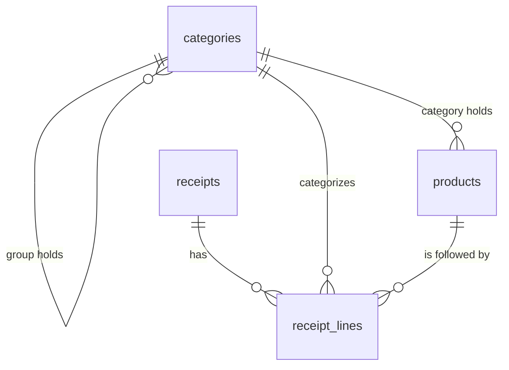

# Data Model

- **Status:** In Progress (catalog, receipts with their read data and review state, and
  receipt lines with their categories implemented)
- **Updated:** 2026-10-31

## Overview

The app keeps all its data in one SQLite database. This document describes the schema and
how it changes. Today the schema holds the migration bookkeeping, the catalog (groups,
categories and products), the imported receipts with what was read from them and their
review state, and their lines with their categories.

## Where the database is

| Item | Value |
|---|---|
| File inside the backend container | `/data/db/rrmc.db` |
| Storage | Docker volume `rrmc_rrmc-data`, mounted at `/data/db` |
| Created | On the first start, by `python -m app.prestart` |

The database is not in a Windows folder, because SQLite file locking is unreliable on
Windows folders mounted into Linux containers ([ADR 0002](adr/0002-docker.md)). It survives
`docker compose down` and image rebuilds; `docker compose down -v` deletes it.

Every connection has foreign keys on and uses the WAL journal
(@backend/app/storage/db.py).

## Entities

### schema_version

One row per applied migration.

| Column | Type | Meaning |
|---|---|---|
| `version` | `INTEGER PRIMARY KEY` | Number of the migration file (`0001_...` → 1) |
| `applied_at` | `TEXT NOT NULL` | When it was applied, UTC ISO 8601 |

The schema version is the largest `version`, or 0 when the table is empty.

### categories

Groups and categories share one table, so they share one name namespace (PRD FR-35). A
**group** holds categories and never products; a **category** holds products and belongs to
one group or to none. The hierarchy has at most two levels.

| Column | Type | Meaning |
|---|---|---|
| `id` | `INTEGER PRIMARY KEY` | Stable id |
| `name` | `TEXT NOT NULL` | Display name, as the user typed it after trimming and collapsing spaces |
| `name_key` | `TEXT NOT NULL UNIQUE` | Normalized name, used for every comparison ([normalization](subsystems/categorization/README.md#names)) |
| `kind` | `TEXT NOT NULL`, `group` or `category` | What the row is |
| `parent_id` | `INTEGER`, references `categories (id)`, `ON DELETE RESTRICT` | The group of a category; always `NULL` for a group (`CHECK`) |

### products

| Column | Type | Meaning |
|---|---|---|
| `id` | `INTEGER PRIMARY KEY` | Stable id; linked receipt lines reference it (FR-36) |
| `name` | `TEXT NOT NULL` | Display name |
| `name_key` | `TEXT NOT NULL UNIQUE` | Normalized name; two products cannot share it |
| `category_id` | `INTEGER NOT NULL`, references `categories (id)`, `ON DELETE RESTRICT` | The product's category, never a group |

### app_state

One-time facts about the database, as key and value text.

| Key | Value | Meaning |
|---|---|---|
| `catalog_seeded_at` | UTC ISO 8601 time | The default category list was created; it is never created again, even after the user deletes every item |

### receipts

One row per imported receipt image ([import](subsystems/import/README.md)), with what
[receipt reading](subsystems/receipt-reading/README.md) read from it. The read columns are
`NULL` for receipts imported before reading existed (migration `0003`).

| Column | Type | Meaning |
|---|---|---|
| `id` | `INTEGER PRIMARY KEY` | Stable id; its receipt lines reference it |
| `image_hash` | `TEXT NOT NULL UNIQUE`, `CHECK (length = 64)` | The image identifier: SHA-256 of the file's bytes, lowercase hex. The `UNIQUE` index is the duplicate lookup (FR-3) |
| `file_name` | `TEXT NOT NULL` | The file's name in the done folder, after any numbered suffix |
| `imported_at` | `TEXT NOT NULL` | When the receipt was stored, UTC ISO 8601 with seconds (`2026-10-28T10:00:01Z`) |
| `store` | `TEXT` | Store name as read, trimmed; `''` when the model found none |
| `purchase_date` | `TEXT`, `CHECK` shape `YYYY-MM-DD` | Purchase date; `NULL` when the model's date was not a real date (the user fixes it in review) |
| `total_cents` | `INTEGER` | Receipt total in integer cents (NFR-6) |
| `ocr_text` | `TEXT` | The raw Tesseract output, so the receipt can be re-parsed without OCR (FR-10) |
| `reviewed` | `INTEGER NOT NULL DEFAULT 0`, `0` or `1` | Review state (FR-21): 0 unreviewed, 1 confirmed by the user. Receipts stored before migration `0005` are unreviewed ([review](subsystems/review/README.md)) |

A failed import stores no row, so the image can be retried (FR-4).

### receipt_lines

One row per item line of a receipt, in printed order (receipt-reading spec).

| Column | Type | Meaning |
|---|---|---|
| `id` | `INTEGER PRIMARY KEY` | Stable id |
| `receipt_id` | `INTEGER NOT NULL`, `REFERENCES receipts ON DELETE CASCADE` | The receipt; deleting the receipt deletes its lines |
| `position` | `INTEGER NOT NULL`, `CHECK (≥ 1)`, `UNIQUE` with `receipt_id` | Printed order, from 1 |
| `name` | `TEXT NOT NULL`, `CHECK` not blank | Product name as read |
| `amount_cents` | `INTEGER NOT NULL` | Amount after any discount and including any deposit (FR-9); negative for a deposit refund |
| `is_deposit_refund` | `INTEGER NOT NULL`, `0` or `1` | 1 for a deposit refund (panttipalautus); `CHECK` that such a line is negative |
| `category_id` | `INTEGER`, references `categories (id)`, `ON DELETE RESTRICT` | The line's category; `NULL` when it has none. Always `NULL` for a deposit refund (FR-44) |
| `category_source` | `TEXT`, `remembered`, `model` or `user` | Where the category came from (FR-15); `NULL` exactly when `category_id` is `NULL` |
| `product_id` | `INTEGER`, references `products (id)`, `ON DELETE SET NULL` | The product the line follows (a linked line); only with a category. Deleting the product keeps the category and the source |

Lines stored before migration `0004` have no category. The rules that set these columns are in
[categorization](subsystems/categorization/README.md#line-categorization). Indexes on
`category_id` and `product_id` keep the category delete check and FR-36 updates fast.

### Relationships and rules

- `UNIQUE`, `CHECK` and `RESTRICT` are a safety net. "A parent is a group" and "a product's
  category is not a group" need another row, which SQLite `CHECK` cannot read, so the
  [categorization services](subsystems/categorization/README.md#rules) enforce them, and
  they also check every rule first to return the right error code and count.
- Product names are personal purchase data: they stay in this database and are never logged.

## Migrations

- Migrations are SQL files in @backend/app/storage/migrations/ named `NNNN_name.sql`
  (four digits, then a short name). Today there are five, `0001_catalog.sql`,
  `0002_receipts.sql`, `0003_receipt_reading.sql`, `0004_line_categories.sql` and
  `0005_receipt_review.sql`, so the schema version is 5.
- On every start, `prestart` and then the app's lifespan apply each file whose number is
  above the schema version, in number order (@backend/app/storage/migrate.py).
- Each file runs in its own transaction together with its `schema_version` row. If it fails,
  that transaction is rolled back, the backend does not start, and the database stays at the
  previous version.
- A migration file must not contain `BEGIN` or `COMMIT`; the runner owns the transaction.
- A committed migration is never edited. A change is a new migration.
- A feature spec that adds tables lists its migration in "Files to Modify" and documents the
  new entities in this file.

## Subsystems

- [storage](subsystems/storage/README.md) — owns the connection, the migration runner and
  all SQL
- [categorization](subsystems/categorization/README.md) — the rules on top of the catalog
  tables, and the line categories
- [import](subsystems/import/README.md) — creates the receipt and line rows
- [review](subsystems/review/README.md) — reads receipts and lines for the review UI and
  sets the review state
- [receipt-reading](subsystems/receipt-reading/README.md) — produces the read data

## Related Documents

- [architecture.md](architecture.md): where storage sits among the subsystems
- [Foundation spec](../specs/features/foundation.md) PC4: database requirements
- [Product management spec](../specs/features/product-management.md): the catalog tables
- [Receipt import spec](../specs/features/receipt-import.md): the `receipts` table
- [Receipt reading spec](../specs/features/receipt-reading.md): the read columns and
  `receipt_lines`
- [Categorization spec](../specs/features/categorization.md): the line category columns
- [Receipt review spec](../specs/features/receipt-review.md): the `reviewed` column
- [development.md](development.md#running-the-app): where the data lives when the app runs
